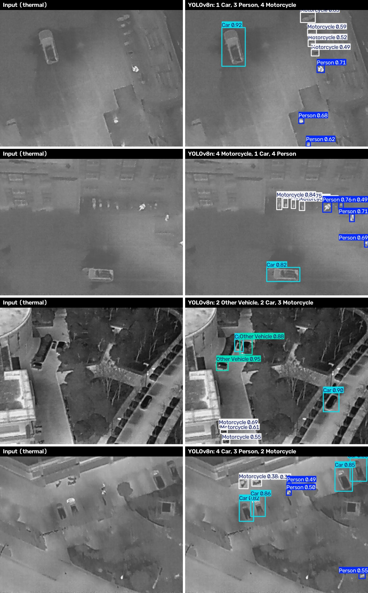
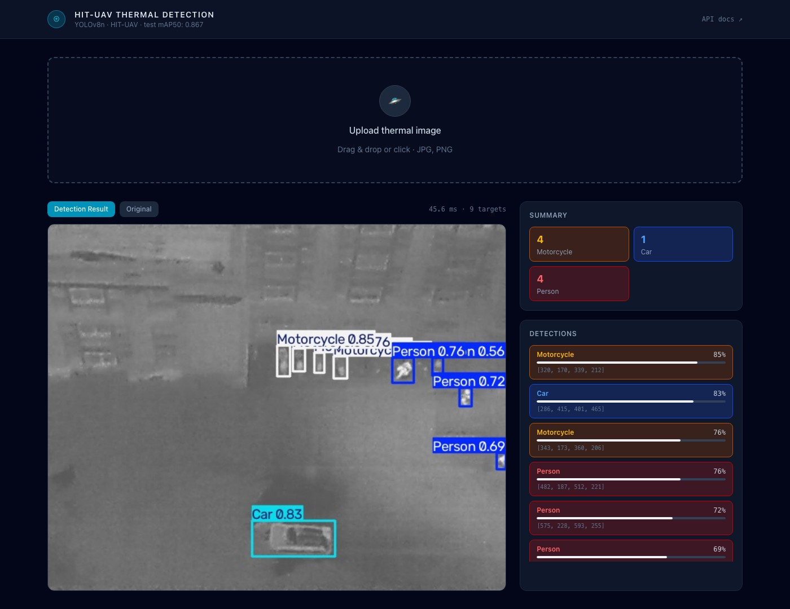

# HIT-UAV Thermal Detection

[](https://github.com/enesbuyuk/hituav-thermal-detection/actions/workflows/ci.yml)


[](LICENSE)

Real-time detection of people and vehicles in **high-altitude infrared thermal imagery** captured by UAVs. A YOLOv8n model is fine-tuned on the [HIT-UAV](https://www.kaggle.com/datasets/pandrii000/hituav-a-highaltitude-infrared-thermal-dataset) dataset after a thermal-specific preprocessing pipeline. It's served through a FastAPI inference API and a Next.js web interface.


<p align="center"><sub>Raw thermal frames from the HIT-UAV test split (left) and model predictions (right).</sub></p>

## Features

- **Thermal preprocessing**: Median filtering, CLAHE and unsharp masking to counter sensor noise and the low contrast typical of thermal frames
- **Lightweight detector**: YOLOv8n (~3.0M parameters) reaches **0.867 mAP50** on the test split while staying fast enough for real-time inference
- **Reproducible pipeline**: one notebook covers EDA, filtering, preprocessing, training and evaluation. It runs on Google Colab or locally (CUDA, Apple Silicon or CPU)
- **Inference API**: a REST endpoint returns boxes, per-class counts, latency and an annotated image
- **Web demo**: drag-and-drop UI with an annotated or original view and a detection list
- **Tested and linted**: API tests, Ruff, TypeScript checks and GitHub Actions CI

## Table of Contents

- [Results](#results)
- [Quick Start](#quick-start)
- [Installation](#installation)
- [Training](#training)
- [API Reference](#api-reference)
- [Configuration](#configuration)
- [Project Structure](#project-structure)
- [Development](#development)
- [Dataset](#dataset)
- [License](#license)

## Results

YOLOv8n, 50 epochs, 640×640, trained on the preprocessed dataset. Evaluated on the held-out **test split** (571 images, 4,780 boxes):

| Class | Precision | Recall | mAP50 | mAP50-95 |
|---|---:|---:|---:|---:|
| **All classes** | **0.887** | **0.812** | **0.867** | **0.575** |
| Person | 0.906 | 0.862 | 0.921 | 0.487 |
| Car | 0.931 | 0.954 | 0.976 | 0.731 |
| Motorcycle | 0.926 | 0.812 | 0.901 | 0.561 |
| Other Vehicle | 0.784 | 0.618 | 0.670 | 0.520 |

On the validation split the same weights reach 0.885 mAP50. Inference takes a few milliseconds per frame on a GPU or Apple Silicon.

**Observations**
- **Car** scores highest because it has a large, distinctive heat signature.
- **Other Vehicle** is the weakest class. It's heterogeneous (trucks, buses, tractors…) and has only ~150 labeled instances, about 0.6% of all boxes.

## Quick Start

```bash
git clone https://github.com/enesbuyuk/hituav-thermal-detection.git
cd hituav-thermal-detection

make install    # creates .venv, installs backend (pip) and frontend (npm) dependencies
make dev        # API on http://localhost:8000, web UI on http://localhost:9999
```

Open **http://localhost:9999** and drop in a thermal image. Example frames are in [`samples/`](samples/).



The trained weights ship with the repository (`backend/models/best.pt`, ~7 MB), so you don't need to train first. For step-by-step instructions, see [Installation](#installation).

## Installation

### Prerequisites

| Tool | Version | Check |
|---|---|---|
| Git | any | `git --version` |
| Python | 3.11+ | `python3 --version` |
| Node.js (with npm) | 20.9+ | `node --version` |
| Make | any (optional) | `make --version` |

Make ships with most Linux distributions and with the Xcode Command Line Tools on macOS. On Windows, use WSL or follow the manual steps below.

### 1. Clone the repository

```bash
git clone https://github.com/enesbuyuk/hituav-thermal-detection.git
cd hituav-thermal-detection
```

### 2. Install the backend

With Make:

```bash
make install-backend
```

Or manually:

```bash
python3 -m venv .venv
source .venv/bin/activate          # Windows: .venv\Scripts\activate
pip install --upgrade pip
pip install -r backend/requirements.txt
```

> **No GPU?** Install the CPU-only PyTorch build first. It's a much smaller download:
> `pip install torch torchvision --index-url https://download.pytorch.org/whl/cpu`

### 3. Install the frontend

```bash
cd frontend
npm install
cp .env.example .env               # optional: change NEXT_PUBLIC_API_URL if the API runs elsewhere
cd ..
```

(`make install-frontend` runs the same `npm install`.)

### 4. Run

Start both services together:

```bash
make dev
```

Or run them in two terminals:

```bash
# Terminal 1: API
source .venv/bin/activate
uvicorn backend.main:app --reload --port 8000

# Terminal 2: web UI
cd frontend
npm run dev
```

### 5. Verify

```bash
curl http://localhost:8000/health
# {"status":"ok","model":"best.pt","classes":["Person","Car","Motorcycle","Other Vehicle"]}
```

Then open **http://localhost:9999** and upload one of the images in `samples/`.

### Troubleshooting

| Problem | Fix |
|---|---|
| `backend/models/best.pt not found` | Make sure the clone finished and the file exists, or train your own model (see [Training](#training)) and copy `best.pt` there |
| `Address already in use` | Another process is using port 8000 or 9999. Stop it, or change the port (`--port` for uvicorn, `-p` in `frontend/package.json`) |
| The UI shows `Failed to fetch` | Check that the API is running and that `NEXT_PUBLIC_API_URL` matches it. If the UI runs on a different origin, add it to `CORS_ORIGINS` |
| `pip install` is slow or very large | Install the CPU-only PyTorch build (see step 2) |

## Training

### Pipeline

```
Raw thermal frame
   ├─ Median filter 3×3         nonlinear; removes salt-and-pepper sensor noise while preserving edges
   ├─ CLAHE (clip 2.0, 8×8)     adaptive local contrast enhancement
   └─ Unsharp masking (k=0.5)   sharpens object boundaries: (1+k)·img − k·blur
        ↓
YOLOv8n (COCO-pretrained) → fine-tuned 50 epochs @ 640×640
```

### Option A: Google Colab

1. Open [`notebooks/hit_uav_yolov8.ipynb`](notebooks/hit_uav_yolov8.ipynb) in Colab with a **T4 GPU** runtime.
2. Add your Kaggle API token to **Colab Secrets** as `KAGGLE_API_TOKEN` and enable notebook access.
3. Run all cells. Weights are written to `/content/runs/detect/train/weights/best.pt`.

### Option B: Local

```bash
make dataset      # install training deps + download HIT-UAV (needs KAGGLE_API_TOKEN or ~/.kaggle/kaggle.json)
make preprocess   # Median → CLAHE → Unsharp → dataset/hit-uav-processed
make train        # YOLOv8n, 50 epochs → runs/detect/train/
cp runs/detect/train/weights/best.pt backend/models/best.pt
```

The device is selected automatically: CUDA, then Apple Silicon (MPS), then CPU. Override it with `make train DEVICE=cpu`. The notebook also runs locally and detects the environment automatically.

## API Reference

Interactive OpenAPI docs are served at **http://localhost:8000/docs**.

| Method | Endpoint | Description |
|---|---|---|
| `GET` | `/health` | Service status, loaded model and class names |
| `POST` | `/detect` | Run detection on an uploaded image (`multipart/form-data`, field `file`) |

```bash
curl -F "file=@samples/thermal_1.jpg" http://localhost:8000/detect
```

```jsonc
{
  "detections": [
    { "class_name": "Car", "class_id": 1, "confidence": 0.93, "bbox": [x1, y1, x2, y2] }
  ],
  "counts": { "Car": 1, "Person": 3 },
  "total": 4,
  "inference_ms": 21.4,
  "annotated_image": "<base64 JPEG>",
  "original_image": "<base64 JPEG>"
}
```

| Status | Reason |
|---|---|
| `400` | File is not an image, or cannot be decoded |
| `413` | Image is larger than 15 MB |

## Configuration

| Variable | Default | Applies to |
|---|---|---|
| `MODEL_PATH` | `backend/models/best.pt` | Backend: weights to load |
| `CONF_THRESHOLD` | `0.25` | Backend: minimum detection confidence |
| `CORS_ORIGINS` | `http://localhost:9999` | Backend: comma-separated allowed origins |
| `NEXT_PUBLIC_API_URL` | `http://localhost:8000` | Frontend: API base URL (see `frontend/.env.example`) |

## Project Structure

```
.
├── backend/
│   ├── main.py                 # FastAPI app: /health, /detect
│   ├── models/best.pt          # Trained YOLOv8n weights
│   └── requirements.txt
├── frontend/                   # Next.js 16 + Tailwind CSS 4 web UI
│   └── app/page.tsx
├── notebooks/
│   └── hit_uav_yolov8.ipynb    # End-to-end pipeline: EDA → filtering → preprocessing → training → evaluation
├── scripts/
│   └── preprocess.py           # CLI version of the preprocessing pipeline
├── tests/
│   └── test_api.py             # API tests on the sample images
├── samples/                    # Example thermal frames
├── docs/images/                # README figures
├── hituav_data.yaml            # YOLOv8 dataset config
├── Makefile                    # Common tasks (make help)
├── setup.sh                    # venv + dataset download
├── requirements.txt            # Training / notebook dependencies
└── requirements-dev.txt        # Test and lint tooling
```

## Development

```bash
make install-dev   # backend deps + pytest, httpx2, ruff
make test          # API tests
make lint          # ruff + TypeScript type check
make help          # all available commands
```

CI runs linting, the API test suite and a production frontend build on every push and pull request.

## Dataset

**HIT-UAV** contains 2,898 infrared thermal images sampled from 43,470 frames recorded by a UAV at 60–130 m altitude, with camera angles of 30°–90°.
The Kaggle release used here contains 2,866 labeled images: 2,008 train, 287 validation and 571 test.

| ID | Class | Notes |
|---|---|---|
| 0 | `Person` | Small, variable heat signature |
| 1 | `Car` | Large, distinct heat signature |
| 2 | `Motorcycle` | Motorcycles and bicycles |
| 3 | `Other Vehicle` | Trucks, buses and other vehicles |

The original oriented bounding boxes are converted to axis-aligned YOLO format (`class x_center y_center width height`, normalized). Boxes labeled `DontCare` (ambiguous regions) are removed during preprocessing. The data is split 70% train / 10% validation / 20% test.

> Suo, J., Wang, T., Zhang, X. et al. *HIT-UAV: A high-altitude infrared thermal dataset for Unmanned Aerial Vehicle-based object detection.* Scientific Data 10, 227 (2023).

The dataset isn't redistributed in this repository. The images in `samples/` and `docs/images/` are a small subset used for illustration. Refer to the dataset's own license for terms of use.

## License

The source code is released under the [MIT License](LICENSE).

The model is trained with [Ultralytics YOLOv8](https://github.com/ultralytics/ultralytics), which is licensed under AGPL-3.0. Check Ultralytics' licensing terms before using the trained weights commercially.
